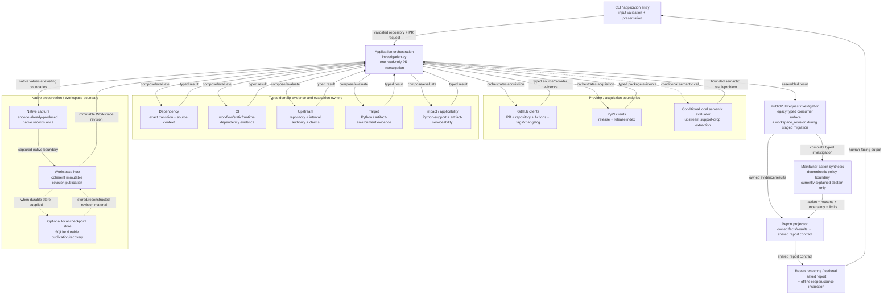

# UpgradePilot current-state subsystem/responsibility diagram candidate

**Status:** research candidate; non-controlling  
**Track:** Project understanding and documentation architecture  
**Repository horizon:** study branch after `1267a4de123c5fdfad222ebe687bee74b400108b`  
**Purpose:** test whether one high-level internal responsibility map materially improves engineer onboarding without falsely presenting Python modules as independently deployed services.

## Reader question

> Inside the current UpgradePilot application, what are the major responsibility owners and how do evidence/results move between them?

This is a **logical responsibility view of one local application/process**, not a deployment diagram and not a claim that each box is a service.

## Evidence basis

Current source establishes:

- `investigation.py` is the application orchestration boundary for one read-only public-PR investigation;
- GitHub/PyPI/upstream acquisition clients are injected provider boundaries;
- dependency, CI, target, upstream and impact packages own distinct evidence/evaluation responsibilities;
- `NativeInvestigationCapture` captures already-produced native values once and does not reacquire/evaluate/retry/publish on its own;
- `InvestigationWorkspaceHost` publishes coherent native progress; default publication is volatile unless a durable store is supplied;
- the ordinary application result still carries legacy typed investigation fields while `workspace_revision` is the immutable canonical Workspace boundary during staged migration;
- maintainer-action synthesis is a separate deterministic policy boundary and currently admits only explained `abstain`;
- report projection copies owned facts/results into a shared report contract without reparsing domains, reacquiring evidence, or inventing new impact/action inference.

Primary anchors checked:

- `src/upgradepilot/investigation.py`
- `src/upgradepilot/workspace/native_capture.py`
- `src/upgradepilot/workspace/checkpoint_store.py`
- `src/upgradepilot/maintainer_action.py`
- `src/upgradepilot/report_projection.py`
- top-level `src/upgradepilot/` package structure

## Candidate diagram

## Why this helps

This view conveys several facts that a directory tree alone does not:

1. **Application orchestration is distinct from domain ownership.** `investigation.py` coordinates but does not semantically own every result it carries.
2. **Providers are not the domain model.** GitHub/PyPI/local semantic interfaces acquire or produce bounded inputs/results; downstream owners decide their admitted meaning.
3. **Domain responsibilities are separate.** Dependency identity, CI execution/consumption, upstream authority, target evidence and impact/applicability are not one generic `analysis` layer.
4. **Workspace/native preservation is downstream of native production, not a replacement evaluator.** Capture records already-produced native values; it does not rerun providers/evaluators.
5. **The staged migration is visible.** `PublicPullRequestInvestigation` still carries legacy typed consumer fields while the Workspace revision exists as the immutable canonical boundary.
6. **Action synthesis is separate from technical evaluation.** It does not reinterpret a domain result into a more active action without positive proof; current admitted action is abstain.
7. **Report projection is a projection boundary, not another analysis engine.** It copies owned facts/results and explicit unknowns/limitations into the shared report contract.

## Important non-claims

The diagram does **not** establish that:

- every domain branch always activates;
- the domain boxes execute in one strict linear order;
- each package is an independent deployable service/process;
- every provider call is performed on every investigation;
- Workspace durable storage is enabled by default;
- the legacy investigation surface is the final architecture rather than an active staged migration boundary;
- report projection itself establishes new domain truth;
- current action synthesis supports merge/check/block/defer decisions beyond abstention;
- this exact package topology is a permanent public API.

## Comparison with the context diagram

The two diagram candidates answer different questions:

| Diagram | Question | Key value |
| --- | --- | --- |
| System context | What is outside UpgradePilot and how does the product interact with it? | User/external-provider/trust/deployment orientation |
| Subsystem/responsibility | What are the major logical owners inside UpgradePilot and how do they relate? | Architecture/onboarding/change-responsibility orientation |

They are therefore **complementary rather than redundant**.

The context diagram should stay small enough that a reviewer can understand the product boundary in under a minute. The subsystem view can carry the richer internal ownership model. Optional report/checkpoint detail may therefore be reduced in the final context view if the Engineering Guide includes the subsystem/state views nearby.

## C4 relationship

This is closest to a **C4 container/component-style logical view**, but deliberately does not use the C4 `Container` label because UpgradePilot's current product is not a distributed set of separately deployable containers/services.

The useful C4 principle retained is zoom level: first show the whole system in context, then zoom into a manageable set of internal responsibility blocks.

## Mermaid/tooling observation after two candidates

After the context and subsystem experiments, Mermaid has real advantages for this repository:

- source is reviewable as text;
- diagrams live in Markdown beside non-claims and evidence anchors;
- changes are visible in Git diffs;
- GitHub renders the notation directly;
- no binary design asset or external diagram editor is required.

Risks:

- large flowcharts become unreadable quickly;
- layout is partly renderer-controlled;
- labels can imply stronger sequencing/deployment semantics than intended;
- diagrams can still drift even when stored as text.

**Provisional tooling disposition:** `KEEP_PARTIAL / ADOPT_LATER_IF_EARNED` for Mermaid as the default *simple architecture-flow notation* if the final Engineering Guide is adopted. Do not make Mermaid mandatory for every diagram or create diagrams merely because the syntax is available.

## Initial disposition

**Subsystem/responsibility diagram: `ADOPT_LATER_IF_EARNED` — strong positive.**

It captures a real missing orientation layer and, together with the context view, would materially reduce the amount of source/document synthesis required from a new or returning engineer.

**Pair recommendation:** if the future Engineering Guide is promoted, include both:

1. a reduced context-style view;
2. a one-process subsystem/responsibility view.

Add dynamic/sequence diagrams later only for flows that remain difficult to understand after these two views.