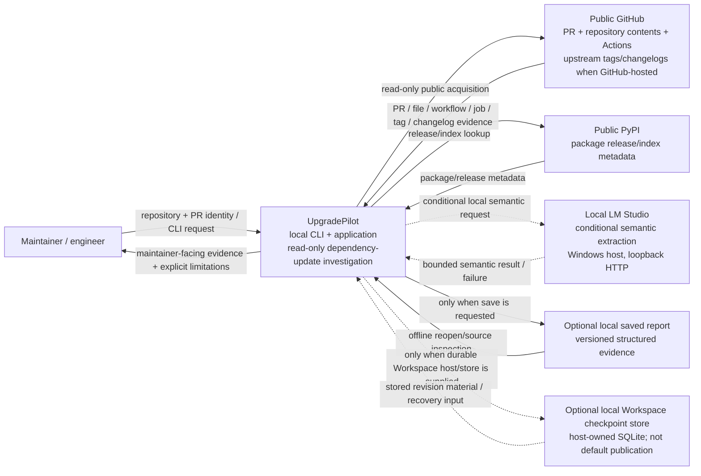

# UpgradePilot current-state system-context diagram candidate

**Status:** research candidate; non-controlling  
**Track:** Project understanding and documentation architecture  
**Repository horizon:** study branch after `f28543f6588ace630bf0ed01518166b5a73b32c8`  
**Purpose:** test whether a small C4-inspired current-state context view materially improves human understanding before adopting architecture diagrams in the future Engineering Guide.

## Evidence basis

The current product/application evidence establishes:

- the normal application responsibility is one **read-only public pull-request investigation** coordinated by `investigate_public_pull_request`;
- the application directly composes GitHub pull-request, Actions, repository, tag and changelog clients;
- it composes PyPI release and release-index clients plus an upstream-repository resolver;
- the support-drop evaluator may call the admitted local semantic runtime;
- the default Workspace publication is **volatile** and chooses no filesystem location; a supplied schema-2 store enables durable publication;
- the CLI can print an evidence report and optionally save/reopen a local structured report;
- the local development/product execution control plane is WSL2, while the admitted LM Studio service runs on the Windows host over loopback HTTP.

Primary anchors checked:

- `README.md`
- `ENVIRONMENT.md`
- `src/upgradepilot/investigation.py`
- `src/upgradepilot/workspace/checkpoint_store.py`

## Reader question

> What sits outside UpgradePilot, who uses it, and what external systems does one normal investigation interact with?

This is deliberately **not** the diagram for internal modules, Workspace internals, detailed evidence flow, or deployment/recovery mechanics.

## Candidate diagram

## Why this helps

This view makes several important boundaries visible at once:

1. **UpgradePilot is currently a local product/application, not a hosted microservice system.**
2. GitHub and PyPI are evidence providers; UpgradePilot does not control their evidence availability or freshness.
3. LM Studio is a **conditional local semantic service**, not the central system of record and not required for every product path.
4. Saved reports and durable Workspace checkpoints are local owned artifacts with different responsibilities.
5. Durable Workspace publication is not silently implied by every investigation; default Workspace publication is volatile.
6. The product returns evidence/limitations to a human maintainer rather than mutating the target repository.

Those are high-value orientation facts that are currently distributed across README, environment, application source and Workspace persistence code.

## Important non-claims

The diagram must **not** be read as claiming:

- every investigation calls every external system;
- every upstream repository is a distinct non-GitHub service;
- local-model output is authoritative by itself;
- a saved report is a replayable investigation or durable Workspace checkpoint;
- a Workspace checkpoint is written by default;
- SQLite is a remote database/service;
- UpgradePilot currently performs target-repository writes, comments, approvals or merges;
- successful connectivity means evidence sufficiency or maintainer-action permission.

## C4 relationship

This is **C4-inspired**, not strict C4 adoption.

Useful C4 idea retained:

- one person;
- one software system in scope;
- external systems/resources;
- directional relationships with plain-language meanings.

Deliberate deviation:

- optional local report/checkpoint artifacts are shown because their distinction is unusually important to UpgradePilot's mental model, even though a strict System Context diagram might defer owned storage to a lower-level view.

If this makes the context too busy, the final Engineering Guide can move the report/checkpoint boxes into the subsystem/state diagram and keep only Maintainer + UpgradePilot + GitHub + PyPI + LM Studio here.

## Representation/tooling experiment

Mermaid is used **only as a research experiment** because:

- it is text-reviewable in Git;
- GitHub can render Mermaid in Markdown;
- the diagram source stays near the explanation;
- changes can be reviewed in diffs.

This does not yet adopt Mermaid as an UpgradePilot documentation standard.

Evaluation criteria before adoption:

- readable without specialist diagram notation knowledge;
- no false deployment/service implications;
- easy to update when architecture changes;
- text diff remains understandable;
- rendered result is usable on GitHub;
- a plain table/prose version would not be materially clearer/cheaper.

## Initial judgment

**Context-style architecture diagram: `ADOPT_LATER_IF_EARNED` — positive candidate.**

This first candidate appears to add real value because it compresses several cross-file boundaries into one inspectable picture without trying to own their semantics.

**Mermaid: `EXPERIMENT_IF_TRIGGERED`.** One successful diagram is insufficient to make it the project-wide notation standard.

## Next comparison

Create a second **internal subsystem/responsibility diagram** for the current one-process UpgradePilot application. It should answer:

> Inside UpgradePilot, what are the major responsibility owners and how does evidence/control move between them?

That diagram must avoid presenting Python packages as independent deployable services. After both diagrams exist, compare whether the context view and subsystem view are complementary or redundant.